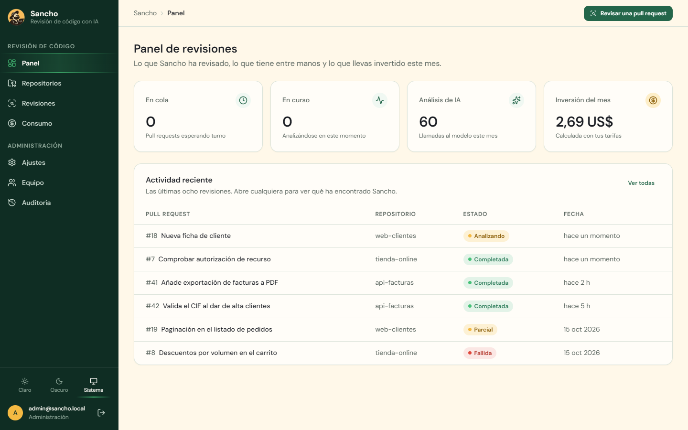
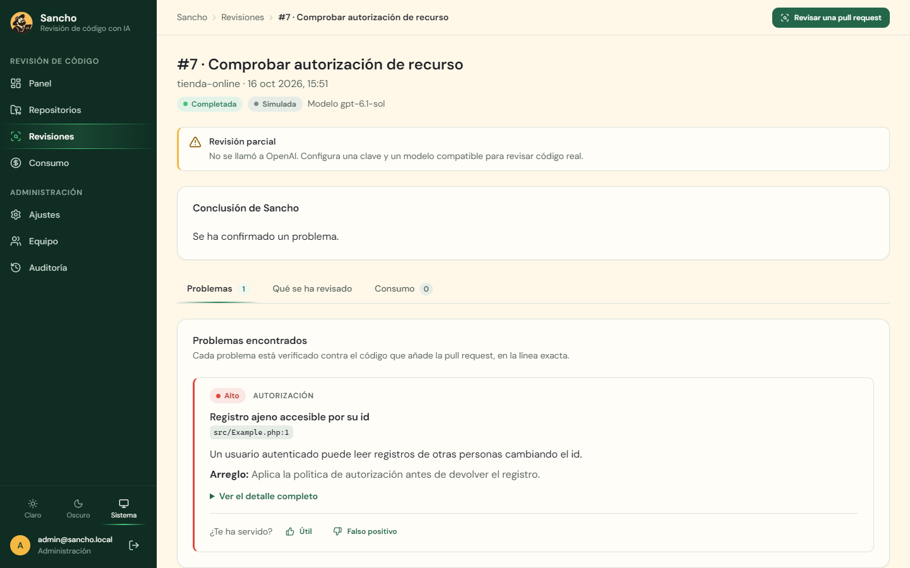
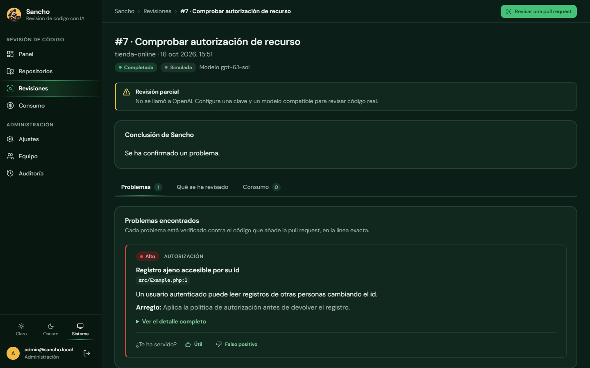
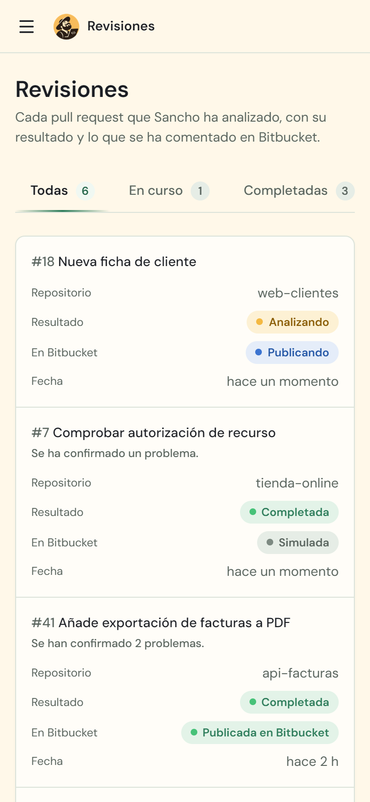
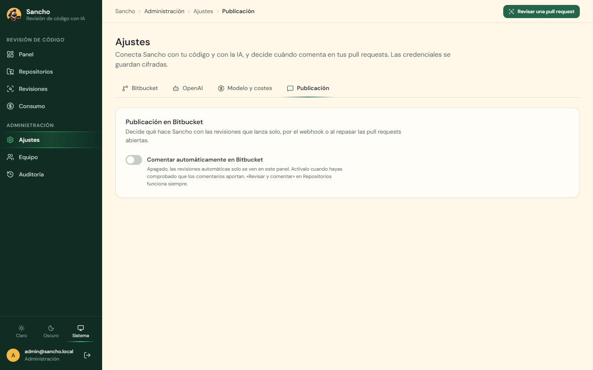
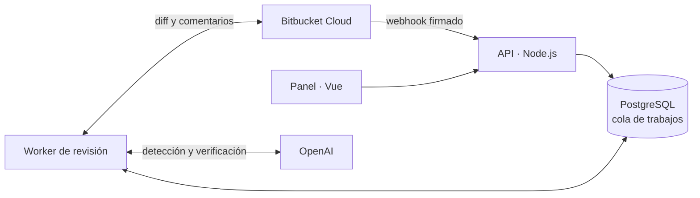

<div align="center">


# Sancho

**El escudero de tus pull requests.**<br>
Revisa con IA cada pull request de Bitbucket Cloud y comenta, en la línea exacta, los problemas que de verdad importan.

[English](README.md) · **Español**

[](https://github.com/Dasge97/sancho/commits/main)
[](https://bitbucket.org)
[](https://platform.openai.com)
[](https://nodejs.org)
[](https://www.typescriptlang.org)
[](https://vuejs.org)
[](https://www.postgresql.org)
[](#instalación)
[](#licencia)
[](https://github.com/Dasge97/sancho/commits/main)



[](#instalación)
&nbsp;
[](docs/04-revision.md)

</div>

> **Estado:** V1 desplegada y probada contra Bitbucket Cloud y OpenAI reales en un repositorio de prueba. Falta evaluar la calidad con pull requests reales del equipo antes de activar los comentarios automáticos. El detalle está en [PROGRESS.md](PROGRESS.md).

## Para qué sirve

Toda aventura necesita a alguien que haga la pregunta incómoda: **«¿Y si ese usuario intenta ver los datos de otro?»**

Sancho es esa segunda mirada para tus pull requests. Lee los cambios, consulta el código relacionado y comenta solo lo que puede demostrar: fallos de seguridad, de autorización y regresiones. Está pensado para equipos de **PHP, Symfony y Laravel** que trabajan en **Bitbucket Cloud**, y es especialmente útil cuando quien programa también es una IA.

Sancho informa y comenta. **La decisión de fusionar sigue siendo de tu equipo**: nunca aprueba, bloquea ni fusiona una pull request.

## Qué hace

- **Revisa solo cada pull request** en cuanto se abre o recibe cambios, gracias a un webhook por repositorio. Los borradores se omiten.
- **Lee antes de opinar**: el diff a commits fijos y los ficheros que cambian, con los secretos ocultados antes de enviar nada a la IA.
- **Se revisa a sí mismo**: una segunda llamada al modelo descarta lo que no puede justificar, y el servidor comprueba que cada problema está en una línea añadida.
- **Comenta con tres frases**: qué pasa, por qué importa y cómo se arregla, en la línea exacta. Un resumen por pull request, que se actualiza en lugar de repetirse.
- **No repite comentarios** entre versiones de la misma pull request y no publica resultados de un código que ya ha cambiado.
- **Separa «no he encontrado nada» de «no he podido revisarlo»**: una revisión parcial o fallida se ve como tal.
- **Controla el gasto**: coste por revisión y por día, y un presupuesto mensual que avisa sin frenar las revisiones.
- **Panel para todo el equipo**, con cuentas locales, dos roles (miembro y administración), auditoría de cambios y modo claro y oscuro.

| Comentario en la pull request | Detalle en el panel |
| --- | --- |
| 🔴 **Inyección SQL en la búsqueda**<br>Un usuario puede eludir el filtro y leer facturas ajenas.<br>**Arreglo:** usa parámetros enlazados en `DB::select`. · Detalle |  |

<div align="center">





</div>

## Instalación

Necesitas Docker con Docker Compose. Node.js 22.12 o superior solo hace falta para desarrollar fuera de Docker.

```bash
git clone https://github.com/Dasge97/sancho.git
cd sancho
cp .env.example .env
```

Rellena el `.env` con valores propios:

```bash
openssl rand -hex 32      # para POSTGRES_PASSWORD y SESSION_SECRET
openssl rand -base64 32   # para SANCHO_ENCRYPTION_KEY (guárdala fuera del servidor)
```

Arranca y crea la primera cuenta de administración:

```bash
docker compose up --build -d
docker compose exec api node dist-server/admin.js tu@correo.com 'una-contraseña-de-12-o-más'
```

Abre `http://localhost:3000` y entra.

**Para publicarlo en internet** (necesario para que Bitbucket envíe los webhooks): pon tu dominio en `PUBLIC_BASE_URL` y `CADDY_DOMAIN`, cambia `SESSION_COOKIE_SECURE=true` y arranca con `docker compose --profile production up --build -d`. Caddy se encarga del certificado HTTPS. Si ya tienes un proxy con HTTPS, apúntalo al puerto `SANCHO_PORT` y no uses el perfil `production`.

## Uso

1. **Ajustes → Bitbucket**: guarda el workspace, el correo de la cuenta de Atlassian y un API token, y pulsa «Probar conexión».
2. **Ajustes → OpenAI**: guarda la clave de la API. En **Modelo y costes**, elige el modelo y sus tarifas, y comprueba que responde.
3. **Repositorios → Sincronizar con Bitbucket**: activa los repositorios que quieras y pulsa «Instalar webhook» en cada uno.
4. Abre una pull request en Bitbucket. En menos de un minuto tendrás la revisión en **Revisiones**.
5. Cuando los comentarios te convenzan, activa **Ajustes → Publicación** para que Sancho comente en Bitbucket él solo. Mientras tanto, «Revisar y comentar» en Repositorios publica a mano.

<div align="center">

</div>

## Configuración

| Variable | Para qué sirve |
| --- | --- |
| `POSTGRES_PASSWORD` | Contraseña de la base de datos. |
| `SESSION_SECRET` | Firma de las sesiones del panel. |
| `SANCHO_ENCRYPTION_KEY` | Cifra las credenciales de Bitbucket y OpenAI (32 bytes en base64). Sin ella no se pueden leer ni las copias de seguridad. |
| `SESSION_COOKIE_SECURE` | `true` con HTTPS; `false` solo en local. |
| `PUBLIC_BASE_URL` | URL pública del panel. Hace falta para instalar webhooks y para los enlaces «Detalle» de los comentarios. |
| `CADDY_DOMAIN` | Dominio para el certificado HTTPS de Caddy (perfil `production`). |
| `SANCHO_PORT` | Puerto local del panel (por defecto `3000`, solo en `127.0.0.1`). |
| `OPENAI_MAX_OUTPUT_TOKENS` | Límite de salida por llamada a OpenAI (por defecto `16000`; incluye el razonamiento). |

**Permisos del API token de Atlassian** (créalo en id.atlassian.com con «Create API token with scopes» y la aplicación Bitbucket): `read:repository:bitbucket`, `read:pullrequest:bitbucket`, `write:pullrequest:bitbucket`, `read:webhook:bitbucket` y `write:webhook:bitbucket`. La cuenta tiene que ser administradora de los repositorios para instalar el webhook. Los comentarios salen con el nombre de esa cuenta, así que conviene una cuenta solo para Sancho.

**Copias de seguridad**: `sh scripts/backup.sh [carpeta]` guarda un volcado de PostgreSQL y `sh scripts/restore.sh <fichero.dump>` lo restaura.

**Pruebas**: `npm test`. Con `TEST_DATABASE_URL` apuntando a una base de datos desechable, también se prueba el recorrido webhook → revisión → publicación con Bitbucket y OpenAI simulados. Para ver el panel con datos de ejemplo sin conectar nada: `docker compose exec api node dist-server/simulator.js`.

## Cómo funciona



El API recibe los webhooks, comprueba su firma y deja un trabajo en una cola de PostgreSQL. El worker lee el diff, pide a la IA los posibles problemas, le pide después que los verifique y comprueba él mismo que cada uno está en una línea añadida. Antes de publicar, confirma que la pull request no ha cambiado de commit. El código y los comentarios de los repositorios se tratan como datos, nunca como instrucciones, y Sancho no ejecuta nunca el código que revisa.

El detalle está en [docs/](docs/): [arquitectura](docs/03-arquitectura.md), [motor de revisión](docs/04-revision.md), [datos y contratos](docs/05-contratos.md) y [validación y operación](docs/07-validacion-operacion.md).

## Documentación

| Documento | Contenido |
| --- | --- |
| [Decisiones y alcance](docs/01-decisiones.md) | Qué está decidido y qué sigue siendo propuesta. |
| [Panel y experiencia](docs/02-panel.md) | Pantallas, acciones, roles y estados. |
| [Arquitectura](docs/03-arquitectura.md) | Componentes, integraciones y secretos. |
| [Motor de revisión](docs/04-revision.md) | Contexto, verificación, comentarios y concurrencia. |
| [Datos y contratos](docs/05-contratos.md) | Entidades, API interna y consumo. |
| [Implementación](docs/06-implementacion.md) | Fases, tareas y criterios de aceptación. |
| [Validación y operación](docs/07-validacion-operacion.md) | Pruebas, evaluación de calidad y despliegue. |
| [Correcciones futuras](docs/08-correcciones.md) | «Sancho, arréglalo»: lo que vendrá después de la V1. |
| [Progreso](PROGRESS.md) | Qué está hecho y comprobado de verdad. |

## Licencia

Todavía sin licencia. Mientras no se publique una, el código está visible pero todos los derechos están reservados.

---

<div align="center">

**Sancho. El sentido común también merece un sitio en la pull request.**

*«Con su permiso: eso no es un gigante. Es un null sin comprobar.»*

</div>
