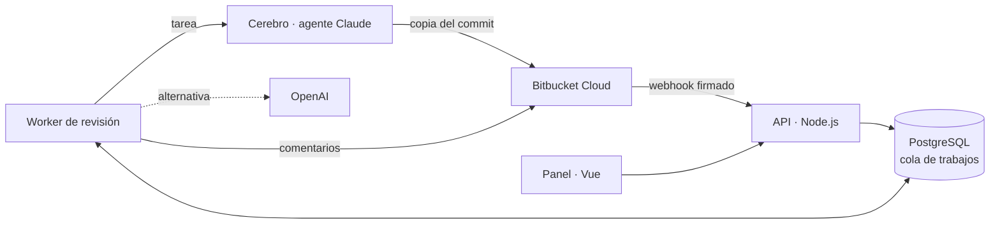

<div align="center">

<picture>
  <source media="(prefers-color-scheme: dark)" srcset="docs/img/logo-oscuro.png">
  
</picture>

### El escudero de tus pull requests

Revisión de código con IA para **Bitbucket Cloud**.<br>
Encuentra fallos de seguridad y regresiones antes de fusionar, y te los señala en la línea exacta.

[English](README.md) · **Español**

[](https://github.com/Dasge97/sancho/commits/main)
[](#licencia)
[](https://github.com/Dasge97/sancho/commits/main)
<br>
[](https://bitbucket.org)
[](https://code.claude.com/docs/en/agent-sdk)
[](https://nodejs.org)
[](https://vuejs.org)
[](https://www.postgresql.org)
[](#instalación)

[](#instalación)
&nbsp;
[](#cómo-funciona)
&nbsp;
[](#capturas)

</div>

<br>


<br>

> **Estado:** V1 funcionando y desplegada. Revisa pull requests reales de Bitbucket Cloud. Antes de dejar que comente sola en todos tus repositorios, conviene probarla con pull requests reales de tu equipo. Lo que está hecho y comprobado, en [PROGRESS.md](PROGRESS.md).

## Por qué Sancho

Toda aventura necesita a alguien que haga la pregunta incómoda: **«¿Y si ese usuario intenta ver los datos de otro?»**

| 🎯 Solo lo que importa | 📍 En la línea exacta | 🤝 Tú decides |
| --- | --- | --- |
| Fallos de seguridad, de autorización y regresiones que puede demostrar. Nada de estilo ni de opiniones. | Tres frases por problema: qué pasa, por qué importa y cómo se arregla, en la línea que lo provoca. | Sancho comenta. Nunca aprueba, bloquea ni fusiona: la decisión sigue siendo de tu equipo. |

Está pensado para equipos que trabajan con **PHP (Laravel, Symfony), JavaScript y TypeScript (Node, React, Vue) y Python (Django, Flask, FastAPI)** en Bitbucket Cloud, y es especialmente útil cuando quien programa también es una IA.

## Así se ve en tu pull request

Un comentario en la línea del problema:

> 🔴 **Inyección SQL en la búsqueda**
>
> Un usuario puede eludir el filtro y leer facturas de otros usuarios.
>
> **Arreglo:** usa parámetros enlazados en `DB::select` para `q`. · [Detalle](#)

Y un resumen por pull request, que se actualiza con cada cambio en lugar de repetirse:

> **Sancho · 2 problemas** (2 altos)
> 1. 🔴 Inyección SQL en la búsqueda · `InvoiceController.php:28`
> 2. 🔴 Descarga de facturas ajenas por id · `InvoiceController.php:33`
>
> 3 ficheros revisados · commit `a41c09e` · [Ver revisión completa](#)

Si el arreglo cabe en la línea, lo propone tal cual, como cambio sugerido:

> ```suggestion
> $invoice = Invoice::findOrFail($id);
> $this->authorize('view', $invoice);
> ```

Y si le respondes, contesta en el mismo hilo:

> **Ana:** Esta ruta solo la usan administradores, no es un problema.
>
> **Sancho:** Tienes razón: la ruta lleva el middleware `can:admin`. Retiro el comentario.<br>
> 📝 Lo tendré en cuenta en este repositorio: _las rutas de admin/ ya exigen can:admin._

## Qué hace

| | |
| --- | --- |
| **Revisa sola cada pull request** | En cuanto se abre o recibe cambios, gracias a un webhook por repositorio. Los borradores se omiten. |
| **Conoce tu proyecto** | La primera vez estudia el repositorio entero y escribe su ficha: cómo se organiza, cómo se protege y qué vigilar. La lee antes de cada revisión y la propone como PR en `.sancho/proyecto.md` para que el equipo la corrija. |
| **Lee el código como lo haría una persona** | Un agente de Claude trabaja sobre una copia del repositorio y decide qué abrir: rutas, políticas, modelos y quién llama a lo que cambia. |
| **Usa herramientas que no ejecutan nada** | gitleaks busca secretos en las líneas añadidas, `php -l` comprueba que los PHP cambiados compilan y Opengrep señala patrones inseguros, que el modelo comprueba antes de publicar. |
| **Se revisa a sí mismo** | Un segundo agente intenta tumbar cada hallazgo antes de publicarlo, y Sancho comprueba que está en una línea añadida. |
| **Propone el arreglo** | Cuando el cambio cabe en la línea comentada, lo deja como sugerencia de código. |
| **Contesta en la PR** | Responde en el hilo de sus comentarios, retira lo que no es un problema y atiende `@sancho revisa`, `pausa`, `reanuda` y `ayuda`. |
| **Aprende de tu equipo** | Lo que le explicáis en las PR y los falsos positivos marcados con su motivo se convierten en reglas del repositorio. |
| **Sigue cada problema hasta el final** | Con un commit nuevo se fija en lo que ha cambiado; si un problema ya está arreglado, lo dice en el hilo y lo marca como resuelto. |
| **Distingue «limpio» de «no revisado»** | Una revisión parcial o fallida se ve como tal, nunca como una revisión sin problemas. |
| **Se configura desde el repositorio** | Un `.sancho.yml` con contexto, reglas por carpeta, exclusiones, gravedad mínima, perfil y comprobaciones, leído de la rama de destino. |
| **Revisión estándar o exigente** | La exigente también comenta detalles menores (🔵), como mucho cinco por PR, nunca estilo. |
| **Comprobaciones antes de fusionar** | El equipo escribe las suyas y el resumen dice de cada una si se cumple, no se cumple o no aplica. |
| **Un resumen que ayuda a repartir el trabajo** | Esfuerzo de revisión del 1 al 5 con los minutos estimados, y las PR abiertas que tocan los mismos ficheros. |
| **Se adapta a tu equipo** | Reglas generales y por repositorio, y las instrucciones de la IA editables desde el panel, con historial de versiones. |
| **Mide cuánto acierta** | La pantalla Calidad da el acierto por tipo, por repositorio y por versión de las instrucciones. Además, `npm run eval` pasa casos etiquetados. |
| **Controla el gasto** | Coste por revisión y por día, y un presupuesto mensual que avisa sin frenar el trabajo. |
| **Un panel para todo el equipo** | Cuentas locales, dos roles, auditoría de cambios, modo claro y oscuro, y adaptado a móvil. |

## Cómo funciona



1. **Llega la pull request.** Bitbucket avisa por webhook; Sancho comprueba la firma y la pone en cola.
2. **Sancho lo prepara.** Lee el `.sancho.yml` de la rama de destino, la ficha del proyecto (si no existe, la escribe), lo que ha aprendido del equipo y los comentarios que siguen abiertos. Pasa gitleaks y `php -l`, que no ejecutan el proyecto.
3. **El agente la revisa.** El servicio `cerebro` descarga el repositorio en el commit de la pull request y lanza un agente del Claude Agent SDK con las instrucciones de [`prompts/`](prompts/) y las reglas de tu equipo. El agente lee lo que necesita, y **solo puede leer, y solo dentro de esa copia**.
4. **Otro agente lo verifica.** Cada hallazgo se contrasta con el código; los que no se sostienen se descartan.
5. **Sancho publica.** Antes de comentar, confirma que la pull request no ha cambiado. Después publica el resumen y los comentarios en línea, y cierra los comentarios anteriores que ya están arreglados.
6. **Sancho atiende las respuestas.** Cuando alguien contesta a un comentario suyo o le escribe `@sancho`, responde en el hilo.

El agente usa la suscripción de Claude del servidor o una clave de Anthropic. Como alternativa, Ajustes → Motor de revisión permite usar OpenAI directamente. El detalle está en [docs/](docs/).

## Capturas

<table>
  <tr>
    <td width="50%"><br><sub><b>Panel.</b> Lo que se ha revisado, lo que está en marcha y lo que llevas gastado.</sub></td>
    <td width="50%"><br><sub><b>Revisiones.</b> Cada pull request con su resultado y lo que se publicó.</sub></td>
  </tr>
  <tr>
    <td><br><sub><b>Motor de revisión.</b> Agente de Claude por suscripción, clave de Anthropic u OpenAI.</sub></td>
    <td><br><sub><b>Instrucciones de la IA.</b> Editables desde el panel, con historial de versiones.</sub></td>
  </tr>
  <tr>
    <td><br><sub><b>Reglas del equipo.</b> Qué vigilar y qué ignorar, en general y por repositorio.</sub></td>
    <td><br><sub><b>Modo oscuro.</b> Y qué ficheros abrió el agente en cada revisión.</sub></td>
  </tr>
  <tr>
    <td><br><sub><b>Conversaciones.</b> Lo que el equipo le dice en las PR y lo que contesta.</sub></td>
    <td><br><sub><b>Lo aprendido.</b> Reglas que salen de las conversaciones y de los falsos positivos.</sub></td>
  </tr>
  <tr>
    <td colspan="2"><br><sub><b>Calidad.</b> Cuánto de lo que señala le sirve al equipo, por versión de las instrucciones, tipo y repositorio.</sub></td>
  </tr>
</table>

<p align="center">
  
  &nbsp;&nbsp;
  
</p>

## Instalación

Necesitas un servidor con **Docker Compose** y una dirección pública con HTTPS, para que Bitbucket pueda enviar los webhooks.

```bash
git clone https://github.com/Dasge97/sancho.git
cd sancho
cp .env.example .env
```

Rellena el `.env` con valores propios:

```bash
openssl rand -hex 32      # POSTGRES_PASSWORD, SESSION_SECRET y CEREBRO_TOKEN
openssl rand -base64 32   # SANCHO_ENCRYPTION_KEY (guarda una copia fuera del servidor)
```

Pon tu dominio en `PUBLIC_BASE_URL` y `CADDY_DOMAIN`, y la carpeta de la sesión de Claude Code del servidor en `CLAUDE_DIR`. Después arranca y crea tu cuenta:

```bash
docker compose --profile production up --build -d
docker compose exec api node dist-server/admin.js tu@correo.com 'una-contraseña-de-12-o-más'
```

El perfil `production` añade Caddy, que saca el certificado HTTPS solo. Si ya tienes un proxy con HTTPS, apúntalo al puerto `SANCHO_PORT` y arranca sin el perfil.

## Primeros pasos

1. **Ajustes → Bitbucket:** guarda el workspace, el correo de la cuenta de Atlassian y un API token, y pulsa «Probar conexión».
2. **Ajustes → Motor de revisión:** comprueba que el agente de Claude sale «Conectado».
3. **Ajustes → Reglas de revisión:** cuéntale a Sancho de qué va cada proyecto. Es opcional, pero mejora mucho los resultados.
4. **Repositorios → Sincronizar con Bitbucket:** activa los repositorios que quieras y pulsa «Instalar webhook».
5. Abre una pull request. En unos minutos tendrás la revisión en **Revisiones**.
6. Cuando los comentarios te convenzan, activa **Ajustes → Publicación** para que Sancho comente solo. Mientras tanto, «Revisar y comentar» publica a mano.

**El API token de Atlassian** se crea en id.atlassian.com con «Create API token with scopes» y la aplicación Bitbucket. Necesita `read:repository`, `read:pullrequest`, `write:pullrequest`, `read:webhook` y `write:webhook`, y la cuenta tiene que administrar los repositorios. Añade `write:repository` si quieres que Sancho proponga la ficha del proyecto como PR; si no, desactiva «Proponer la ficha del proyecto como PR» en Ajustes → Publicación. Los comentarios salen con su nombre, así que conviene una cuenta solo para Sancho.

Si un repositorio sale con «Webhook antiguo», pulsa «Actualizar webhook»: el nuevo avisa también de los comentarios, y sin él Sancho no puede contestar en las PR.

## Hablar con Sancho en la pull request

Responde en el hilo de un comentario suyo para explicarle por qué no es un problema o decirle que ya está arreglado. Sancho contesta en el mismo hilo, retira el comentario si tienes razón y, si es algo que vale para el resto del repositorio, lo apunta como regla.

También puedes escribirle en cualquier comentario de la PR:

| Mensaje | Qué hace |
| --- | --- |
| `@sancho revisa` | Revisa la PR otra vez y publica el resultado. |
| `@sancho pausa` | Deja de revisar sola esta PR. `@sancho revisa` sigue funcionando. |
| `@sancho reanuda` | Vuelve a revisarla con cada cambio. |
| `@sancho ayuda` | Contesta con esta lista. |
| `@sancho` y una pregunta | Contesta sobre la PR o el proyecto. |

Lo que aprende queda en **Repositorios → (repositorio) → Lo aprendido**. Ahí se puede corregir, desactivar o borrar.

## Configuración

| Variable | Para qué sirve |
| --- | --- |
| `POSTGRES_PASSWORD` | Contraseña de la base de datos. |
| `SESSION_SECRET` | Firma de las sesiones del panel. |
| `SANCHO_ENCRYPTION_KEY` | Cifra las credenciales guardadas (32 bytes en base64). Sin ella no se pueden leer ni las copias de seguridad. |
| `PUBLIC_BASE_URL` | URL pública del panel, para los webhooks y los enlaces de los comentarios. |
| `CADDY_DOMAIN` | Dominio del certificado HTTPS (perfil `production`). |
| `SESSION_COOKIE_SECURE` | `true` con HTTPS; `false` solo en local. |
| `CEREBRO_TOKEN` | Token interno entre el worker y el agente. |
| `CLAUDE_DIR` | Sesión de Claude Code del servidor, para que el agente trabaje por suscripción. |
| `ANTHROPIC_API_KEY` | Opcional: el agente usa esta clave (pago por uso) en vez de la suscripción. |
| `SANCHO_PORT` | Puerto local del panel (por defecto `3000`, solo en `127.0.0.1`). |
| `AI_EXCHANGE_RETENTION_DAYS` | Días que se guarda lo enviado a la IA y su respuesta (por defecto `30`). |

### Desde el repositorio: `.sancho.yml`

El equipo puede configurar a Sancho junto al código con un `.sancho.yml` en la raíz. Sancho lo lee de la rama de destino de cada PR, así que una PR no puede relajar sus propias reglas. Todos los campos son opcionales.

```yaml
contexto: |
  API de facturación en Laravel 11 para clientes B2B.
  Cada factura pertenece a un usuario; los administradores ven todas.
reglas: |
  Toda acción que cambia datos usa un FormRequest con authorize().
rutas:
  - ruta: "app/Http/Controllers/Admin/**"
    reglas: "Solo accesible con el middleware can:admin."
excluir:
  - "database/seeders/**"
gravedad_minima: medium   # low, medium, high o critical
perfil: exigente          # estandar o exigente (también detalles menores)
comprobaciones:
  - nombre: Migraciones reversibles
    descripcion: Toda migración nueva tiene un método down() que deshace el cambio.
```

La ficha del proyecto vive en `.sancho/proyecto.md`. Si el equipo la edita en el repositorio, Sancho usa esa versión desde la siguiente revisión.

## Seguridad

- **El agente solo lee.** No ejecuta el código revisado, no escribe ficheros y no sale a internet; un filtro rechaza cualquier ruta fuera de la copia del repositorio.
- **Las herramientas tampoco ejecutan nada.** gitleaks lee texto y `php -l` solo compila. El valor de un secreto encontrado no se guarda ni se muestra.
- **El código revisado es dato, no instrucciones.** Lo que diga un fichero no cambia lo que hace Sancho.
- **Los secretos no llegan a la IA.** Las líneas con claves o contraseñas se ocultan antes de enviar nada.
- **Las credenciales se guardan cifradas** (AES-256-GCM) y nunca vuelven al panel.
- **Sancho no decide por ti.** No usa las APIs de aprobar, rechazar ni fusionar.

## Desarrollo

```bash
npm ci
npm test                         # pruebas unitarias
TEST_DATABASE_URL=postgres://… npm test   # y el recorrido completo con Bitbucket y la IA simulados
docker compose exec api node dist-server/simulator.js   # datos de ejemplo sin conectar nada
```

**Medir la calidad con casos etiquetados.** [`evals/casos/`](evals/casos/) tiene trece cambios de proyectos Laravel, Express y Django, y un script del navegador: ocho con un problema conocido y cinco limpios. `npm run eval` los pasa por la misma detección y verificación que el worker y da la precisión, la cobertura y el coste. Llama de verdad a OpenAI:

```bash
OPENAI_API_KEY=… npm run eval -- --modelo gpt-6.1-sol --precios 2,10
npm run eval -- --modelo gpt-6.1-sol --prompts otra-version/   # compara con otras instrucciones
docker compose run --rm -e OPENAI_API_KEY worker node dist-server/eval.js --modelo gpt-6.1-sol   # en el servidor
```

Para añadir casos, edita [`evals/generar.mjs`](evals/generar.mjs) y ejecuta `node evals/generar.mjs evals/casos`.

Para ver qué se envió a la IA en una revisión: `docker compose exec api node dist-server/ai-log.js [id-de-revisión]`.
Copias de seguridad: `sh scripts/backup.sh` y `sh scripts/restore.sh <fichero.dump>`.

## Documentación

[Decisiones](docs/01-decisiones.md) · [Panel](docs/02-panel.md) · [Arquitectura](docs/03-arquitectura.md) · [Motor de revisión](docs/04-revision.md) · [Datos y contratos](docs/05-contratos.md) · [Validación y operación](docs/07-validacion-operacion.md) · [Correcciones futuras](docs/08-correcciones.md) · [Progreso](PROGRESS.md)

## Licencia

Todavía sin licencia. Mientras no se publique una, el código está visible pero todos los derechos están reservados.

---

<div align="center">


**Sancho. El sentido común también merece un sitio en la pull request.**

<sub><i>«Con su permiso: eso no es un gigante. Es un null sin comprobar.»</i></sub>

</div>
