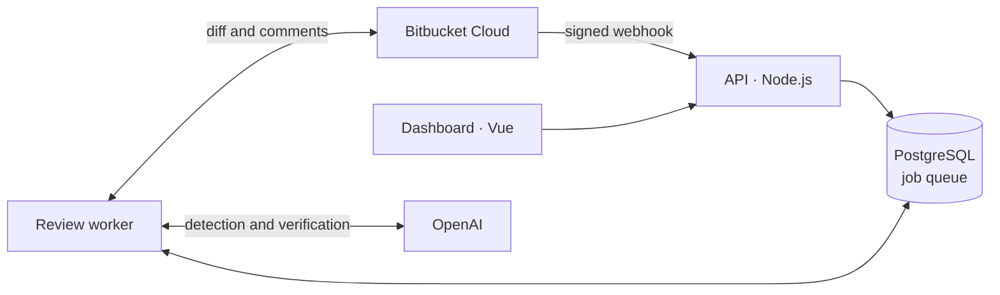

<div align="center">


# Sancho

**The squire for your pull requests.**<br>
AI review for every Bitbucket Cloud pull request, with comments on the exact line for the problems that really matter.

**English** · [Español](README.es.md)

[](https://github.com/Dasge97/sancho/commits/main)
[](https://bitbucket.org)
[](https://platform.openai.com)
[](https://nodejs.org)
[](https://www.typescriptlang.org)
[](https://vuejs.org)
[](https://www.postgresql.org)
[](#installation)
[](#license)
[](https://github.com/Dasge97/sancho/commits/main)


[](#installation)
&nbsp;
[](#how-it-works)

</div>

> **Status:** V1 deployed and tested against real Bitbucket Cloud and OpenAI on a test repository. Quality still has to be measured on the team's real pull requests before automatic comments are switched on. Details in [PROGRESS.md](PROGRESS.md) (Spanish).
>
> The interface and the review comments are in Spanish. The design documents in [docs/](docs/) are in Spanish too.

## What it is for

Every adventure needs someone to ask the awkward question: **"What if this user tries to read someone else's data?"**

Sancho is that second pair of eyes for your pull requests. It reads the changes, checks related code and only comments on what it can prove: security flaws, authorization gaps and regressions. It is built for **PHP, Symfony and Laravel** teams working on **Bitbucket Cloud**, and it is especially useful when the code is also written by an AI.

Sancho reports and comments. **Merging is still your team's call**: it never approves, blocks or merges a pull request.

## What it does

- **Reviews every pull request on its own** as soon as it is opened or updated, through one webhook per repository. Drafts are skipped.
- **Reads before it speaks**: the diff at fixed commits, the changed files and the code they use (models, policies, routes and access rules), with secrets masked before anything is sent to the AI.
- **Follows your team's rules**: under Ajustes → Reglas de revisión you tell it what each project is about, what to watch and what to ignore.
- **Double-checks itself**: a second model call drops what it cannot justify, and the server checks that each problem sits on an added line.
- **Comments in three sentences**: what is wrong, why it matters and how to fix it, on the exact line. One summary per pull request, updated instead of repeated.
- **Does not repeat itself** across versions of the same pull request and never publishes results for code that has since changed.
- **Tells "nothing found" apart from "could not review"**: a partial or failed review is shown as such.
- **Keeps spending in check**: cost per review and per day, and a monthly budget that warns without stopping reviews.
- **Dashboard for the whole team**, with local accounts, two roles (member and admin), an audit log and light and dark mode.

| Comment on the pull request | Detail in the dashboard |
| --- | --- |
| 🔴 **Inyección SQL en la búsqueda**<br>Un usuario puede eludir el filtro y leer facturas ajenas.<br>**Arreglo:** usa parámetros enlazados en `DB::select`. · Detalle |  |

<div align="center">


</div>

## Installation

You need Docker with Docker Compose. Node.js 22.12 or later is only needed to develop outside Docker.

```bash
git clone https://github.com/Dasge97/sancho.git
cd sancho
cp .env.example .env
```

Fill the `.env` with your own values:

```bash
openssl rand -hex 32      # for POSTGRES_PASSWORD and SESSION_SECRET
openssl rand -base64 32   # for SANCHO_ENCRYPTION_KEY (keep a copy off the server)
```

Start it and create the first admin account:

```bash
docker compose up --build -d
docker compose exec api node dist-server/admin.js you@example.com 'a-password-of-12-or-more'
```

Open `http://localhost:3000` and sign in.

**To put it on the internet** (needed so Bitbucket can send webhooks): set your domain in `PUBLIC_BASE_URL` and `CADDY_DOMAIN`, set `SESSION_COOKIE_SECURE=true` and start with `docker compose --profile production up --build -d`. Caddy handles the HTTPS certificate. If you already have an HTTPS proxy, point it at `SANCHO_PORT` and skip the `production` profile.

## Usage

1. **Ajustes → Bitbucket** (Settings): save the workspace, the Atlassian account email and an API token, then click «Probar conexión» (Test connection).
2. **Ajustes → OpenAI**: save the API key. Under **Modelo y costes** (Model and costs), pick the model and its prices, and check that it answers.
3. **Repositorios → Sincronizar con Bitbucket** (Repositories → Sync): enable the repositories you want and click «Instalar webhook» on each one.
4. Open a pull request in Bitbucket. Within a minute the review shows up under **Revisiones** (Reviews).
5. Once you trust the comments, turn on **Ajustes → Publicación** (Publishing) so Sancho comments in Bitbucket by itself. Until then, «Revisar y comentar» (Review and comment) in Repositories publishes on demand.

<div align="center">

</div>

## Configuration

| Variable | What it does |
| --- | --- |
| `POSTGRES_PASSWORD` | Database password. |
| `SESSION_SECRET` | Signs dashboard sessions. |
| `SANCHO_ENCRYPTION_KEY` | Encrypts the Bitbucket and OpenAI credentials (32 bytes, base64). Without it, not even backups can be read. |
| `SESSION_COOKIE_SECURE` | `true` with HTTPS; `false` only locally. |
| `PUBLIC_BASE_URL` | Public URL of the dashboard. Needed to install webhooks and for the «Detalle» links in comments. |
| `CADDY_DOMAIN` | Domain for Caddy's HTTPS certificate (`production` profile). |
| `SANCHO_PORT` | Local dashboard port (default `3000`, bound to `127.0.0.1` only). |
| `OPENAI_MAX_OUTPUT_TOKENS` | Output limit per OpenAI call (default `16000`; includes reasoning). |
| `AI_EXCHANGE_RETENTION_DAYS` | Days to keep what was sent to OpenAI and its answer (default `30`; `0` to not keep it). Read it with `docker compose exec api node dist-server/ai-log.js [review-id]`. |

**Atlassian API token scopes** (create it at id.atlassian.com with "Create API token with scopes" and the Bitbucket app): `read:repository:bitbucket`, `read:pullrequest:bitbucket`, `write:pullrequest:bitbucket`, `read:webhook:bitbucket` and `write:webhook:bitbucket`. The account must be an admin of the repositories to install the webhook. Comments are posted under that account's name, so a dedicated account for Sancho is a good idea.

**Backups**: `sh scripts/backup.sh [folder]` saves a PostgreSQL dump and `sh scripts/restore.sh <file.dump>` restores it.

**Tests**: `npm test`. With `TEST_DATABASE_URL` pointing at a throwaway database, it also runs the webhook → review → publishing flow with Bitbucket and OpenAI simulated. To see the dashboard with sample data without connecting anything: `docker compose exec api node dist-server/simulator.js`.

## How it works



The API receives the webhooks, checks their signature and puts a job in a PostgreSQL queue. The worker reads the diff, asks the AI for possible problems, asks it again to verify them and checks by itself that each one is on an added line. Before publishing, it confirms the pull request has not moved to a new commit. Repository code and comments are treated as data, never as instructions, and Sancho never runs the code it reviews.

**How the AI reviews.** The model's instructions live in [`prompts/deteccion.md`](prompts/deteccion.md) and [`prompts/verificacion.md`](prompts/verificacion.md) (Spanish): what to look for in Laravel and Symfony, what not to comment on, how to rate severity and how to write each finding. They are sent apart from the code, which gets a number on every line, and end with the rules your team writes in the dashboard.

More in [docs/](docs/) (Spanish): [architecture](docs/03-arquitectura.md), [review engine](docs/04-revision.md), [data and contracts](docs/05-contratos.md) and [validation and operations](docs/07-validacion-operacion.md).

## License

No license yet. Until one is published, the code is visible but all rights are reserved.

---

<div align="center">

**Sancho. Common sense deserves a seat in the pull request too.**

*"With your permission: that is not a giant. It is an unchecked null."*

</div>
