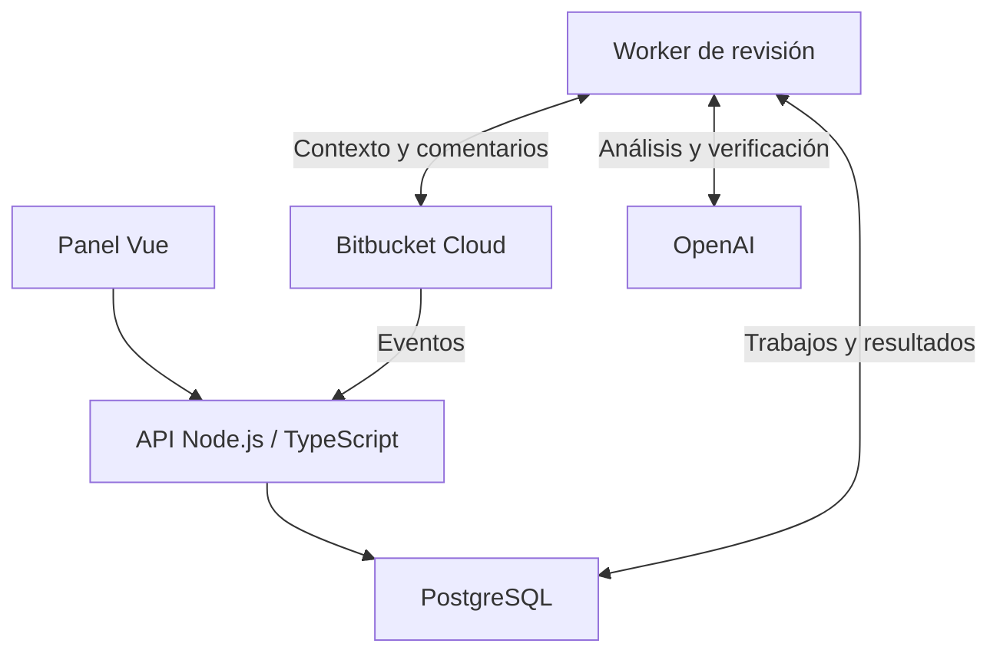

<div align="center">

# 🫏 Sancho

### El escudero de tus pull requests.

**Tú escribes la aventura. Sancho vigila que no termine en producción un viernes.**

Bitbucket Cloud · OpenAI · Node.js · TypeScript · Vue · PostgreSQL · Docker

[La idea](#la-idea) · [Cómo revisará](#cómo-revisará) · [El panel](#el-panel) · [Hoja de ruta](#hoja-de-ruta) · [Documentación](#documentación)

</div>

---

> **Estado: planificación y documentación.**
>
> Este repositorio contiene la especificación y el plan de implementación de Sancho. Las funciones descritas son el alcance previsto; todavía no hay una aplicación ejecutable.
>
> El caballo está ensillado. Falta construir el caballo. Tenemos un plan.

## La idea

Toda aventura necesita a alguien que haga la pregunta incómoda:

**«¿Y si ese usuario intenta acceder a los datos de otro?»**

Sancho es un proyecto de revisor de código con IA para **Bitbucket Cloud**, pensado para equipos que quieren una segunda mirada sobre sus pull requests. Analizará los cambios, consultará código relacionado y comentará los problemas que pueda fundamentar.

Su puesto está al lado del desarrollador: acompañar, poner algo de sensatez y señalar el agujero antes de que alguien se caiga dentro.

Especialmente útil cuando quien programa también es una IA. Alguien tiene que preguntar por qué el molino tiene permisos de administrador.

## Menos sermones. Más problemas reales.

La prioridad de Sancho será **la utilidad de sus comentarios**, no cuántos consiga escribir.

| Lo que buscamos | Lo que queremos evitar |
| --- | --- |
| Un error de autorización con un escenario concreto | «Podrías mejorar la seguridad» |
| Una regresión explicada con código relacionado | Juzgar una función sin mirar quién la llama |
| Un problema de transacciones o migraciones | Preferencias personales disfrazadas de errores |
| Evidencia y una orientación de solución | Comentarios vagos que generan más trabajo |
| Seguimiento de lo ya comentado | Repetir el mismo aviso con cada commit |
| Reconocer que falta contexto | Inventar un diagnóstico para rellenar la revisión |

**Si Sancho no encuentra un problema relevante, no tiene que fabricarse uno.**

Y si no puede completar el análisis, lo dirá. «No he podido revisar esto» y «no he encontrado problemas» son resultados distintos.

## Cómo revisará

1. **Llega una PR.** Recibirá los eventos de Bitbucket en los repositorios activados.
2. **Comprueba el terreno.** Omitirá borradores y agrupará cambios seguidos para trabajar sobre la versión más reciente.
3. **Lee antes de opinar.** Revisará el diff y buscará contexto: rutas, permisos, clases, entidades, migraciones y pruebas relacionadas.
4. **Busca problemas concretos.** La IA propondrá hallazgos con ubicación, escenario e impacto.
5. **Revisa sus propias sospechas.** Una segunda comprobación contrastará la evidencia y descartará lo que no pueda justificar.
6. **Comenta con moderación.** Actualizará un resumen por PR y añadirá comentarios en línea cuando aporten algo.
7. **Acompaña los cambios.** Las nuevas revisiones tendrán en cuenta los hallazgos anteriores.

Antes de publicar, comprobará que el código analizado siga vigente. Un resultado antiguo no deberá hacerse pasar por actual.

La segunda comprobación ayuda a filtrar errores; no convierte a Sancho en infalible. También él puede confundir algún molino.

### Una conversación que sí queremos tener

> **Ejemplo ficticio · Alta · Autorización**
>
> **Esta consulta permite acceder a registros de otro usuario.**
>
> La ruta exige una sesión válida, pero el registro se recupera únicamente por su identificador. En el código consultado no aparece la comprobación de propiedad que utilizan las otras rutas relacionadas.
>
> Un usuario autenticado podría consultar un registro ajeno cambiando ese identificador.
>
> **Propuesta:** aplicar la política de autorización antes de devolver el recurso.

El humor se queda en la personalidad del producto. **Los comentarios de revisión serán claros, respetuosos y concretos.** Nadie necesita que le hagan un chiste mientras intenta entender una fuga de datos.

## El panel

La base de operaciones de Sancho. Desde aquí se configurará el servicio y se podrá ver qué está haciendo, qué ha encontrado y cuánto está costando.

| Sección | Para qué servirá |
| --- | --- |
| **Inicio** | Revisiones recientes, trabajos pendientes, errores y consumo del mes. |
| **Repositorios** | Ver los proyectos accesibles y elegir cuáles revisa Sancho. |
| **Reglas** | Configuración general y ajustes por repositorio: contexto, exclusiones y criterios. |
| **Revisiones** | Hallazgos, cobertura, commits analizados, duración y enlaces a Bitbucket. |
| **IA y consumo** | Clave de OpenAI, modelo, consumo estimado y avisos de presupuesto. |
| **Equipo** | Cuentas, roles y administración de accesos. |

El administrador creará las cuentas; el equipo entrará con correo y contraseña. Todos los miembros tendrán visibilidad sobre los repositorios conectados.

**El presupuesto mensual será un aviso, no un interruptor.** Al superar el umbral configurado, Sancho avisará y seguirá revisando. Los límites técnicos por trabajo impedirán bucles y ejecuciones interminables.

### Una conexión, varios repositorios

La integración se plantea mediante una cuenta de Bitbucket con acceso a los proyectos que se quieran revisar y permisos para comentar.

Conectar una cuenta no activará todos sus repositorios: se elegirán desde el panel. Cada repositorio tendrá su webhook; la herramienta intentará configurarlo automáticamente cuando disponga de los permisos necesarios.

La identidad recomendada es una cuenta técnica del equipo. Así los comentarios tendrán un autor reconocible y la conexión no dependerá de la cuenta personal de un empleado.

## La primera expedición

La primera versión está definida para:

- **Bitbucket Cloud.**
- **PHP, Symfony y Laravel** como primeros proyectos a revisar.
- **OpenAI**, con una clave API del equipo.
- Revisiones al abrir PR y con nuevos cambios, omitiendo borradores.
- Un equipo con varios usuarios y acceso compartido a los proyectos.
- Un VPS o servidor de empresa, desplegado con **Docker**.
- Un volumen inicial previsto de hasta **10 revisiones al día**.

Sancho informará y comentará. **La decisión de fusionar seguirá siendo del equipo.**

La V1 analizará código sin ejecutar los proyectos revisados. No modificará archivos, generará commits, aprobará PR ni bloqueará fusiones. Tampoco afirmará haber ejecutado pruebas que solo ha leído.

El código de Sancho vive en GitHub; los repositorios que revisará están en Bitbucket Cloud. Cada cosa en su alforja.

## Bajo la armadura

**Stack confirmado:** Node.js + TypeScript + Vue + PostgreSQL.

La arquitectura propuesta separa el panel, la API y un proceso de revisión en segundo plano. PostgreSQL conservará configuración, historial, consumo y trabajos pendientes.



Las credenciales permanecerán en el servidor. El código y los comentarios del repositorio se tratarán como datos, nunca como instrucciones capaces de ampliar permisos.

El detalle está en la [arquitectura](docs/03-arquitectura.md) y el [motor de revisión](docs/04-revision.md).

## Hoja de ruta

| Fase | Entrega prevista |
| --- | --- |
| **0 · Preparar las alforjas** | Base técnica, contratos y simuladores. |
| **1 · Montar la posada** | Panel, cuentas, permisos y configuración. |
| **2 · Conocer el camino** | Conexión con Bitbucket, repositorios y eventos. |
| **3 · Aprender a mirar** | Revisiones visibles en el panel y evaluación de calidad. |
| **4 · Tomar la palabra** | Publicación en PR, seguimiento y control de duplicados. |
| **5 · Salir de expedición** | Despliegue, recuperación de errores y puesta en uso. |
| **Después · Echar una mano** | Correcciones solicitadas desde los comentarios. |

Todas las fases de implementación están pendientes. El estado detallado se mantendrá en [PROGRESS.md](PROGRESS.md).

### Después: «Sancho, arréglalo»

La evolución prevista permitirá solicitar una corrección respondiendo a un hallazgo, por ejemplo:

```text
/revisor corregir
```

Sancho comprobaría que la persona está autorizada, trabajaría sobre el problema concreto en un entorno aislado y explicaría qué cambió y qué pudo verificar.

**El comando y la forma de entregar el cambio son propuestas, no funciones disponibles.** Antes de implementarlo se decidirá si añadir un commit a la rama o abrir una PR alternativa, y qué comprobaciones exigir.

El alcance está en [Correcciones futuras](docs/08-correcciones.md).

Un escudero puede echar una mano. Darle las llaves del castillo sin mirar sería otra historia.

## Empezar a desarrollar

Todavía no hay un comando de instalación de la aplicación. Esta entrega contiene la documentación con la que se va a construir.

1. Leer las [decisiones confirmadas y propuestas pendientes](docs/01-decisiones.md).
2. Revisar el [plan por fases y tareas](docs/06-implementacion.md).
3. Usar [HANDOFF.md](HANDOFF.md) como punto de entrada para el modelo implementador.
4. Implementar una tarea, validar sus criterios y actualizar [PROGRESS.md](PROGRESS.md).
5. Continuar con la siguiente entrega comprobable.

El modelo que implemente Sancho y el modelo OpenAI que revise las PR son elecciones independientes. El primero puede cambiar sin alterar el producto; el segundo se configurará y evaluará con ejemplos.

**La documentación busca que el agente tenga menos que adivinar y más que comprobar.**

## Documentación

| Documento | Contenido |
| --- | --- |
| [Decisiones y alcance](docs/01-decisiones.md) | Qué está cerrado y qué sigue siendo propuesta. |
| [Panel y experiencia](docs/02-panel.md) | Pantallas, acciones, roles y estados. |
| [Arquitectura](docs/03-arquitectura.md) | Componentes, integraciones y secretos. |
| [Motor de revisión](docs/04-revision.md) | Contexto, verificación, comentarios y concurrencia. |
| [Datos y contratos](docs/05-contratos.md) | Entidades, API interna y consumo. |
| [Implementación](docs/06-implementacion.md) | Tareas, dependencias y criterios de aceptación. |
| [Validación y operación](docs/07-validacion-operacion.md) | Pruebas, evaluación de calidad y despliegue. |
| [Correcciones futuras](docs/08-correcciones.md) | Alcance posterior y decisiones pendientes. |
| [Fuentes](docs/09-fuentes.md) | Referencias oficiales de las integraciones. |
| [Instrucciones del implementador](HANDOFF.md) | Cómo avanzar sin perder las decisiones del proyecto. |
| [Progreso](PROGRESS.md) | Estado real de cada fase. |

---

<div align="center">

**Sancho. El sentido común también merece un sitio en la pull request.**

*«Con su permiso: eso no es un gigante. Es un null sin comprobar.»*

</div>
